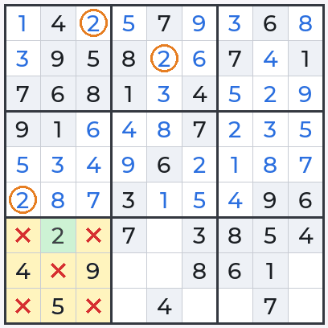

<!-- Written by tools/walkthrough.py disjoint-groups: edit the script, not this page. -->
# Disjoint Groups, step 35: the 2 in box 7

**Step 35 of 48** · [← Step 34](step-34.md) · [All steps](../disjoint-groups.md#the-whole-puzzle-step-by-step) · [Step 36 →](step-36.md)

Box 7 needs a 2. r7c1 and r9c1: column 1 has one (r6c1). r7c3 and r9c3: column 3 has one (r1c3). r8c2: the centre group has one (r2c5). Only **r7c2** is left: **r7c2 = 2**.

**Step 35 of 48** · [← Step 34](step-34.md) · [All steps](../disjoint-groups.md#the-whole-puzzle-step-by-step) · [Step 36 →](step-36.md)
