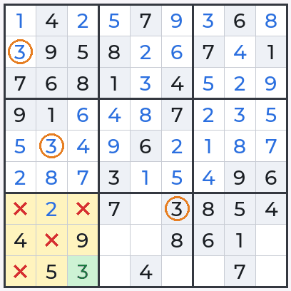

<!-- Written by tools/walkthrough.py disjoint-groups: edit the script, not this page. -->
# Disjoint Groups, step 36: the 3 in box 7

**Step 36 of 48** · [← Step 35](step-35.md) · [All steps](../disjoint-groups.md#the-whole-puzzle-step-by-step) · [Step 37 →](step-37.md)

Box 7 needs a 3. r7c1 and r7c3: row 7 has one (r7c6). r8c2: column 2 has one (r5c2). r9c1: column 1 has one (r2c1). Only **r9c3** is left: **r9c3 = 3**.

**Step 36 of 48** · [← Step 35](step-35.md) · [All steps](../disjoint-groups.md#the-whole-puzzle-step-by-step) · [Step 37 →](step-37.md)
