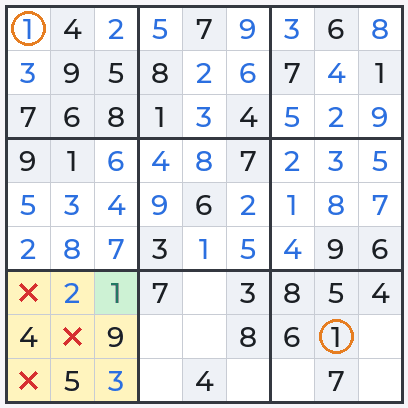

<!-- Written by tools/walkthrough.py disjoint-groups: edit the script, not this page. -->
# Disjoint Groups, step 37: the 1 in box 7

**Step 37 of 48** · [← Step 36](step-36.md) · [All steps](../disjoint-groups.md#the-whole-puzzle-step-by-step) · [Step 38 →](step-38.md)

Box 7 needs a 1. r7c1 and r9c1: column 1 has one (r1c1). r8c2: row 8 has one (r8c8). Only **r7c3** is left: **r7c3 = 1**.

**Step 37 of 48** · [← Step 36](step-36.md) · [All steps](../disjoint-groups.md#the-whole-puzzle-step-by-step) · [Step 38 →](step-38.md)
