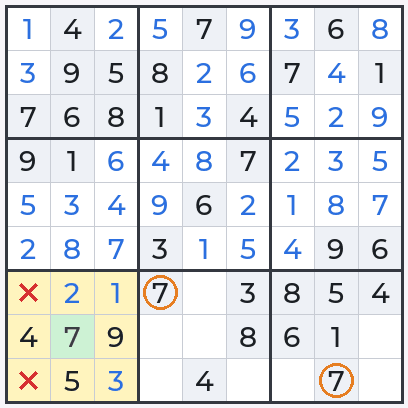

<!-- Written by tools/walkthrough.py disjoint-groups: edit the script, not this page. -->
# Disjoint Groups, step 38: the 7 in box 7

**Step 38 of 48** · [← Step 37](step-37.md) · [All steps](../disjoint-groups.md#the-whole-puzzle-step-by-step) · [Step 39 →](step-39.md)

Box 7 needs a 7. r7c1: row 7 has one (r7c4). r9c1: row 9 has one (r9c8). Only **r8c2** is left: **r8c2 = 7**.

**Step 38 of 48** · [← Step 37](step-37.md) · [All steps](../disjoint-groups.md#the-whole-puzzle-step-by-step) · [Step 39 →](step-39.md)
