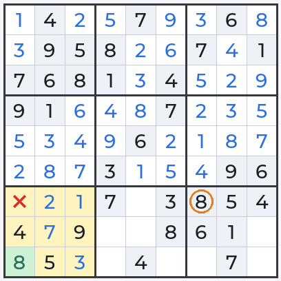

<!-- Written by tools/walkthrough.py disjoint-groups: edit the script, not this page. -->
# Disjoint Groups, step 39: the 8 in box 7

**Step 39 of 48** · [← Step 38](step-38.md) · [All steps](../disjoint-groups.md#the-whole-puzzle-step-by-step) · [Step 40 →](step-40.md)

Box 7 needs an 8. r7c1: row 7 has one (r7c7). Only **r9c1** is left: **r9c1 = 8**.

**Step 39 of 48** · [← Step 38](step-38.md) · [All steps](../disjoint-groups.md#the-whole-puzzle-step-by-step) · [Step 40 →](step-40.md)
