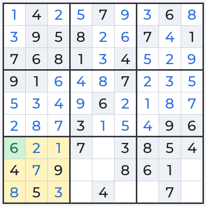

<!-- Written by tools/walkthrough.py disjoint-groups: edit the script, not this page. -->
# Disjoint Groups, step 40: the 6 in box 7

**Step 40 of 48** · [← Step 39](step-39.md) · [All steps](../disjoint-groups.md#the-whole-puzzle-step-by-step) · [Step 41 →](step-41.md)

Box 7 needs a 6, and r7c1 is its last empty cell: **r7c1 = 6**.

**Step 40 of 48** · [← Step 39](step-39.md) · [All steps](../disjoint-groups.md#the-whole-puzzle-step-by-step) · [Step 41 →](step-41.md)
