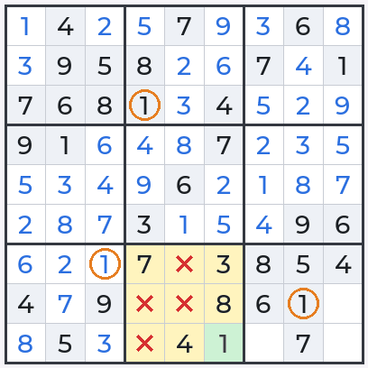

<!-- Written by tools/walkthrough.py disjoint-groups: edit the script, not this page. -->
# Disjoint Groups, step 41: the 1 in box 8

**Step 41 of 48** · [← Step 40](step-40.md) · [All steps](../disjoint-groups.md#the-whole-puzzle-step-by-step) · [Step 42 →](step-42.md)

Box 8 needs a 1. r7c5: row 7 has one (r7c3). r8c4 and r8c5: row 8 has one (r8c8). r9c4: column 4 has one (r3c4). Only **r9c6** is left: **r9c6 = 1**.

**Step 41 of 48** · [← Step 40](step-40.md) · [All steps](../disjoint-groups.md#the-whole-puzzle-step-by-step) · [Step 42 →](step-42.md)
