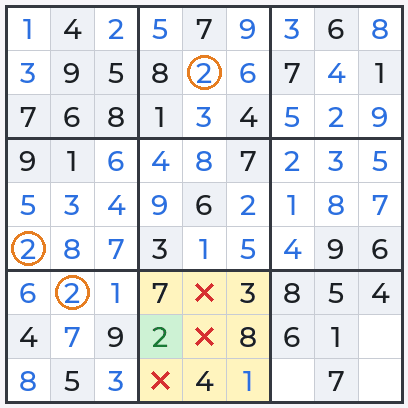

<!-- Written by tools/walkthrough.py disjoint-groups: edit the script, not this page. -->
# Disjoint Groups, step 42: the 2 in box 8

**Step 42 of 48** · [← Step 41](step-41.md) · [All steps](../disjoint-groups.md#the-whole-puzzle-step-by-step) · [Step 43 →](step-43.md)

Box 8 needs a 2. r7c5: row 7 has one (r7c2). r8c5: column 5 has one (r2c5). r9c4: the bottom-left group has one (r6c1). Only **r8c4** is left: **r8c4 = 2**.

**Step 42 of 48** · [← Step 41](step-41.md) · [All steps](../disjoint-groups.md#the-whole-puzzle-step-by-step) · [Step 43 →](step-43.md)
