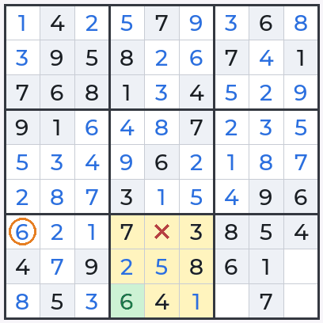

<!-- Written by tools/walkthrough.py disjoint-groups: edit the script, not this page. -->
# Disjoint Groups, step 44: the 6 in box 8

**Step 44 of 48** · [← Step 43](step-43.md) · [All steps](../disjoint-groups.md#the-whole-puzzle-step-by-step) · [Step 45 →](step-45.md)

Box 8 needs a 6. r7c5: row 7 has one (r7c1). Only **r9c4** is left: **r9c4 = 6**.

**Step 44 of 48** · [← Step 43](step-43.md) · [All steps](../disjoint-groups.md#the-whole-puzzle-step-by-step) · [Step 45 →](step-45.md)
