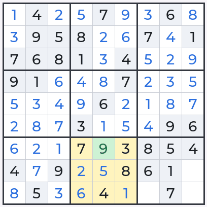

<!-- Written by tools/walkthrough.py disjoint-groups: edit the script, not this page. -->
# Disjoint Groups, step 45: the 9 in box 8

**Step 45 of 48** · [← Step 44](step-44.md) · [All steps](../disjoint-groups.md#the-whole-puzzle-step-by-step) · [Step 46 →](step-46.md)

Box 8 needs a 9, and r7c5 is its last empty cell: **r7c5 = 9**.

**Step 45 of 48** · [← Step 44](step-44.md) · [All steps](../disjoint-groups.md#the-whole-puzzle-step-by-step) · [Step 46 →](step-46.md)
