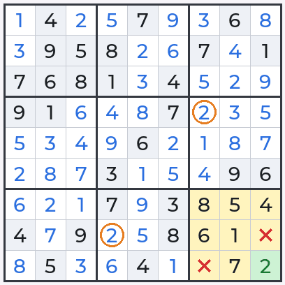

<!-- Written by tools/walkthrough.py disjoint-groups: edit the script, not this page. -->
# Disjoint Groups, step 46: the 2 in box 9

**Step 46 of 48** · [← Step 45](step-45.md) · [All steps](../disjoint-groups.md#the-whole-puzzle-step-by-step) · [Step 47 →](step-47.md)

Box 9 needs a 2. r8c9: row 8 has one (r8c4). r9c7: column 7 has one (r4c7). Only **r9c9** is left: **r9c9 = 2**.

**Step 46 of 48** · [← Step 45](step-45.md) · [All steps](../disjoint-groups.md#the-whole-puzzle-step-by-step) · [Step 47 →](step-47.md)
