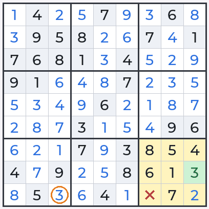

<!-- Written by tools/walkthrough.py disjoint-groups: edit the script, not this page. -->
# Disjoint Groups, step 47: the 3 in box 9

**Step 47 of 48** · [← Step 46](step-46.md) · [All steps](../disjoint-groups.md#the-whole-puzzle-step-by-step) · [Step 48 →](step-48.md)

Box 9 needs a 3. r9c7: row 9 has one (r9c3). Only **r8c9** is left: **r8c9 = 3**.

**Step 47 of 48** · [← Step 46](step-46.md) · [All steps](../disjoint-groups.md#the-whole-puzzle-step-by-step) · [Step 48 →](step-48.md)
