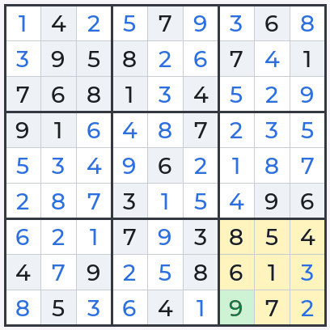

<!-- Written by tools/walkthrough.py disjoint-groups: edit the script, not this page. -->
# Disjoint Groups, step 48: the 9 in box 9

**Step 48 of 48** · [← Step 47](step-47.md) · [All steps](../disjoint-groups.md#the-whole-puzzle-step-by-step) · [All steps](../disjoint-groups.md#the-whole-puzzle-step-by-step)

Box 9 needs a 9, and r9c7 is its last empty cell: **r9c7 = 9**.

Solved.

**Step 48 of 48** · [← Step 47](step-47.md) · [All steps](../disjoint-groups.md#the-whole-puzzle-step-by-step) · [All steps](../disjoint-groups.md#the-whole-puzzle-step-by-step)
