# Double Arrow

[← All variants](README.md) · [Puzzles](../features-puzzles.md) · [How to play](../how-to-play.md)

## The rules

[Classic](classic.md) rules, and **blue lines with a circle at each end**: the two circles' digits **add up to the digits between them**. In 3, 5, 4, 6 the circles 3 and 6 make 9, and so do 5 and 4. The circles can hold the same digit where they don't see each other. A line has 3 to 6 cells.

## On the board

- The lines are thin and blue, from circle to circle, through the cell centres; lines don't cross each other.
- Once both circles are filled, the line's digits turn red when the cells between add up to more than the circles (counting 1 for each empty one), or, all filled, to something else.
- The grader and hints bound each cell by the sums the others still allow: "The two circles at this line's ends add up to the digits between them, so row 2, column 3 can only be 5."
- **Puzzles → ⋮ → New puzzle → Lines → Double Arrow**: 8 lines (Hard and Expert: 10).

## How to solve it

- **The circles make 18 at most** (17 when they see each other), so the cells between can't add up to more.
- **Two cells between: small circles mean small digits.** A line of 4 cells whose middle holds a 7 and an 8 needs circles adding up to 15.
- **One circle known:** the other is the sum between, less it. With the cells between full, the last circle is a subtraction.

## Worked example

**variant-examples #48**, Double Arrow Easy (see [Classic](classic.md#worked-example-the-whole-puzzle) for how to import the examples; cells are written r*row*c*column*).

**Step 1: r2c3.** Column 3 has 1, 2, 7 and 8; row 2 has 3, 4 and 6: that leaves 5 and 9. r2c3 is a circle of the line r1c1, r1c2, r1c3, r2c3, and the 4 and the 2 between add up to 6: a 9 is already too much. **r2c3 = 5** (and the other circle, r1c1, will be 1).

**Step 2: r7c9.** Row 7 has 1, 4, 7 and 8; box 9 has 3 and 9; column 9 has 5: that leaves 2 and 6. r7c9 is a circle of the line r6c7, r7c8, r8c9, r7c9, and the 8 and the 4 between make 12: with a 2, the other circle would need 10. **r7c9 = 6** (and r6c7, the other circle, 6 too: they don't see each other).

**Step 3: r9c2.** Row 9 has 1, 2, 3 and 9; column 2 has 4 and 6; box 7 has 7: that leaves 5 and 8. r9c2 and the 3 in r8c2 are the circles of a short line, the one cell between being r8c1: 8 + 3 = 11, too much for one digit. **r9c2 = 5** (and r8c1 = 8).

## The whole puzzle, step by step

<!-- walkthrough -->
<!-- Written by tools/walkthrough.py double-arrow: edit the script, not this part. -->

The whole puzzle, from the start to the last cell: 52 steps, each one a single (one place left for a digit, or one digit left for a cell), taken in the order a box's single comes first, so not quite the order of the worked example above. In each picture, the unit the step looks at is tinted yellow (for a cell with one digit left: its row, column and box), the new digit is on green, the digits that rule cells out have an **orange ring**, and the empty cells they rule out a **red cross**. Givens are on grey, digits from earlier steps in blue.

#### Step 1: the 2 in box 2

Box 2 needs a 2. r1c5 and r1c6: row 1 has one (r1c3). r2c4 and r3c4: column 4 has one (r5c4). r3c6: column 6 has one (r9c6). Only **r2c5** is left: **r2c5 = 2**.

#### Step 2: the 4 in box 2

Box 2 needs a 4. r1c5 and r1c6: row 1 has one (r1c2). r2c4: row 2 has one (r2c8). r3c4: column 4 has one (r6c4). Only **r3c6** is left: **r3c6 = 4**.

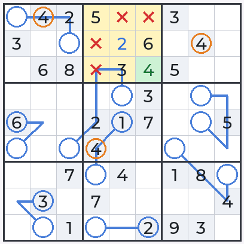

#### Step 3: the 7 in box 2

Box 2 needs a 7. r1c6: column 6 has one (r5c6). r2c4 and r3c4: column 4 has one (r8c4). Only **r1c5** is left: **r1c5 = 7**.

#### Step 4: the 3 in box 6

Box 6 needs a 3. r4c7, r4c8 and r4c9: row 4 has one (r4c6). r5c7 and r6c7: column 7 has one (r1c7). r5c8 and r6c8: column 8 has one (r9c8). Only **r6c9** is left: **r6c9 = 3**.

#### Step 5: the 3 in box 4

Box 4 needs a 3. r4c1, r4c2 and r4c3: row 4 has one (r4c6). r5c2: column 2 has one (r8c2). r6c1, r6c2 and r6c3: row 6 has one (r6c9). Only **r5c3** is left: **r5c3 = 3**.

#### Step 6: the 4 in box 7

Box 7 needs a 4. r7c1 and r7c2: row 7 has one (r7c5). r8c1 and r8c3: row 8 has one (r8c9). r9c2: column 2 has one (r1c2). Only **r9c1** is left: **r9c1 = 4**.

#### Step 7: the 4 in box 4

Box 4 needs a 4. r4c1: column 1 has one (r9c1). r4c2 and r5c2: column 2 has one (r1c2). r6c1, r6c2 and r6c3: row 6 has one (r6c4). Only **r4c3** is left: **r4c3 = 4**.

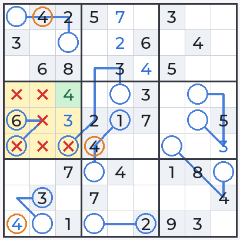

#### Step 8: the 4 in box 6

Box 6 needs a 4. r4c7, r4c8 and r4c9: row 4 has one (r4c3). r5c8: column 8 has one (r2c8). r6c7 and r6c8: row 6 has one (r6c4). Only **r5c7** is left: **r5c7 = 4**.

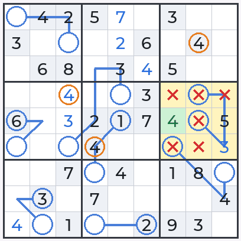

#### Step 9: the 6 in box 7

Box 7 needs a 6. r7c1 and r8c1: column 1 has one (r5c1). r7c2 and r9c2: column 2 has one (r3c2). Only **r8c3** is left: **r8c3 = 6**.

#### Step 10: the 8 in box 7

Box 7 needs an 8. r7c1 and r7c2: row 7 has one (r7c8). r9c2: it's a circle, and with an 8 there the two circles couldn't add up to the cells between them. Only **r8c1** is left: **r8c1 = 8**.

#### Step 11: the 1 in box 8

Box 8 needs a 1. r7c4 and r7c6: row 7 has one (r7c7). r8c5: column 5 has one (r5c5). r9c4 and r9c5: row 9 has one (r9c3). Only **r8c6** is left: **r8c6 = 1**.

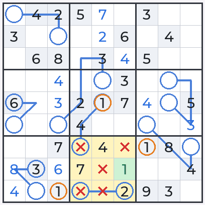

#### Step 12: the 3 in box 8

Box 8 needs a 3. r7c6: column 6 has one (r4c6). r8c5: row 8 has one (r8c2). r9c4 and r9c5: row 9 has one (r9c8). Only **r7c4** is left: **r7c4 = 3**.

#### Step 13: the 8 in box 8

Box 8 needs an 8. r7c6: row 7 has one (r7c8). r8c5: row 8 has one (r8c1). r9c4: it's a circle, and with an 8 there the two circles couldn't add up to the cells between them. Only **r9c5** is left: **r9c5 = 8**.

#### Step 14: the 6 in box 8

Box 8 needs a 6. r7c6: column 6 has one (r2c6). r8c5: row 8 has one (r8c3). Only **r9c4** is left: **r9c4 = 6**.

#### Step 15: the 5 in box 9

Box 9 needs a 5. r7c9 and r9c9: column 9 has one (r5c9). r8c7: column 7 has one (r3c7). Only **r8c8** is left: **r8c8 = 5**.

#### Step 16: the 5 in box 8

Box 8 needs a 5. r8c5: row 8 has one (r8c8). Only **r7c6** is left: **r7c6 = 5**.

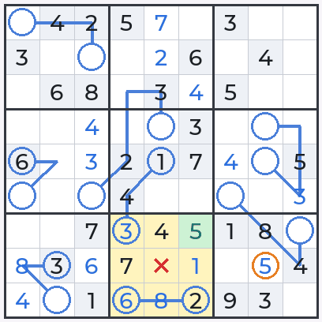

#### Step 17: the 5 in box 7

Box 7 needs a 5. r7c1 and r7c2: row 7 has one (r7c6). Only **r9c2** is left: **r9c2 = 5**.

#### Step 18: the 5 in box 1

Box 1 needs a 5. r1c1: row 1 has one (r1c4). r2c2: column 2 has one (r9c2). r3c1: row 3 has one (r3c7). Only **r2c3** is left: **r2c3 = 5**.

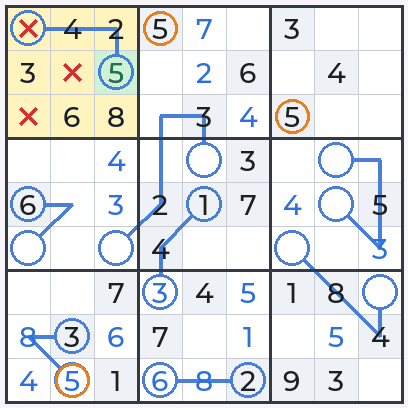

#### Step 19: the 5 in box 4

Box 4 needs a 5. r4c2 and r6c2: column 2 has one (r9c2). r5c2: row 5 has one (r5c9). r6c3: column 3 has one (r2c3). r6c1: it's a circle, and with a 5 there the two circles couldn't add up to the cells between them. Only **r4c1** is left: **r4c1 = 5**.

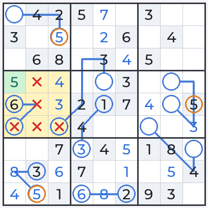

#### Step 20: the 5 in box 5

Box 5 needs a 5. r4c4 and r4c5: row 4 has one (r4c1). r6c6: column 6 has one (r7c6). Only **r6c5** is left: **r6c5 = 5**.

#### Step 21: the 6 in box 5

Box 5 needs a 6. r4c4: column 4 has one (r9c4). r6c6: column 6 has one (r2c6). Only **r4c5** is left: **r4c5 = 6**.

#### Step 22: the 9 in box 8

Box 8 needs a 9, and r8c5 is its last empty cell: **r8c5 = 9**.

#### Step 23: the 2 in box 9

Box 9 needs a 2. r9c9: row 9 has one (r9c6). r7c9: it's a circle, and with a 2 there the two circles couldn't add up to the cells between them. Only **r8c7** is left: **r8c7 = 2**.

#### Step 24: the 6 in box 9

Box 9 needs a 6. r9c9: row 9 has one (r9c4). Only **r7c9** is left: **r7c9 = 6**.

#### Step 25: the 6 in box 3

Box 3 needs a 6. r1c9: column 9 has one (r7c9). r2c7 and r2c9: row 2 has one (r2c6). r3c8 and r3c9: row 3 has one (r3c2). Only **r1c8** is left: **r1c8 = 6**.

#### Step 26: the 6 in box 6

Box 6 needs a 6. r4c7, r4c8 and r4c9: row 4 has one (r4c5). r5c8: row 5 has one (r5c1). r6c8: column 8 has one (r1c8). Only **r6c7** is left: **r6c7 = 6**.

#### Step 27: the 7 in box 9

Box 9 needs a 7, and r9c9 is its last empty cell: **r9c9 = 7**.

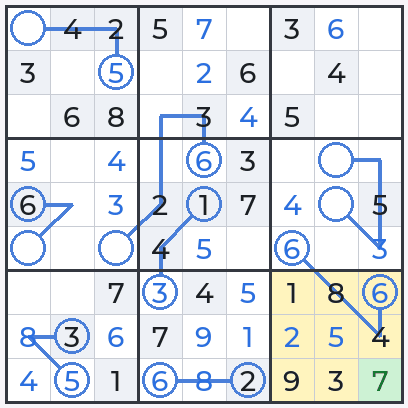

#### Step 28: the 8 in row 5

Row 5 needs an 8. r5c8: column 8 has one (r7c8). Only **r5c2** is left: **r5c2 = 8**.

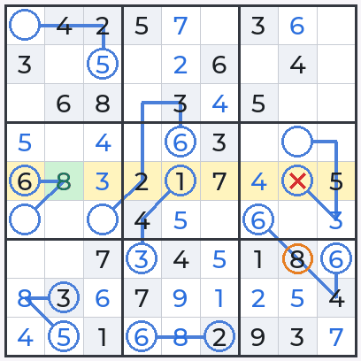

#### Step 29: the 9 in row 5

Row 5 needs a 9, and r5c8 is its last empty cell: **r5c8 = 9**.

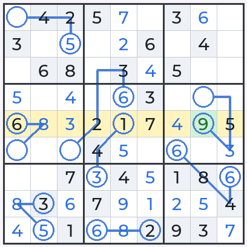

#### Step 30: the 8 in row 6

Row 6 needs an 8. r6c1: column 1 has one (r8c1). r6c2: column 2 has one (r5c2). r6c3: column 3 has one (r3c3). r6c8: column 8 has one (r7c8). Only **r6c6** is left: **r6c6 = 8**.

#### Step 31: the 8 in box 2

Box 2 needs an 8. r1c6: column 6 has one (r6c6). r3c4: row 3 has one (r3c3). Only **r2c4** is left: **r2c4 = 8**.

#### Step 32: the 1 in box 2

Box 2 needs a 1. r1c6: column 6 has one (r8c6). Only **r3c4** is left: **r3c4 = 1**.

#### Step 33: the 9 in box 2

Box 2 needs a 9, and r1c6 is its last empty cell: **r1c6 = 9**.

#### Step 34: the 8 in box 3

Box 3 needs an 8. r2c7 and r2c9: row 2 has one (r2c4). r3c8 and r3c9: row 3 has one (r3c3). Only **r1c9** is left: **r1c9 = 8**.

#### Step 35: the 1 in box 3

Box 3 needs a 1. r2c7: column 7 has one (r7c7). r3c8 and r3c9: row 3 has one (r3c4). Only **r2c9** is left: **r2c9 = 1**.

#### Step 36: the 1 in box 1

Box 1 needs a 1. r2c2: row 2 has one (r2c9). r3c1: row 3 has one (r3c4). Only **r1c1** is left: **r1c1 = 1**.

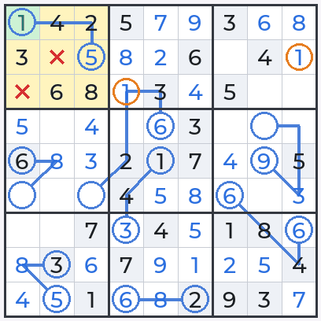

#### Step 37: the 9 in box 3

Box 3 needs a 9. r2c7: column 7 has one (r9c7). r3c8: column 8 has one (r5c8). Only **r3c9** is left: **r3c9 = 9**.

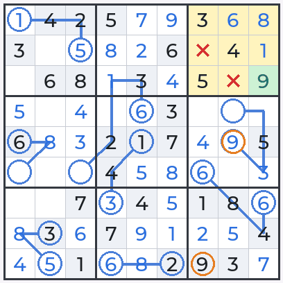

#### Step 38: the 9 in box 1

Box 1 needs a 9. r3c1: row 3 has one (r3c9). Only **r2c2** is left: **r2c2 = 9**.

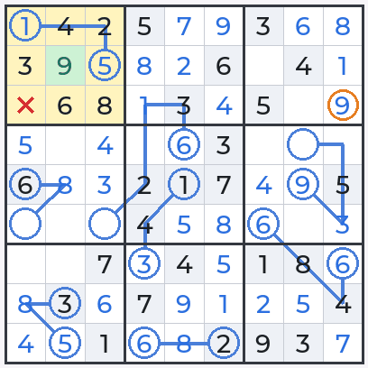

#### Step 39: the 7 in box 1

Box 1 needs a 7, and r3c1 is its last empty cell: **r3c1 = 7**.

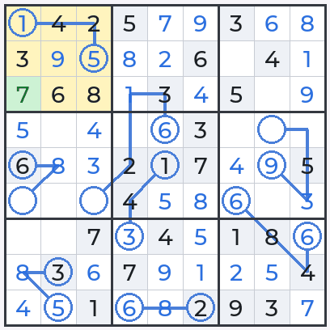

#### Step 40: the 2 in box 3

Box 3 needs a 2. r2c7: row 2 has one (r2c5). Only **r3c8** is left: **r3c8 = 2**.

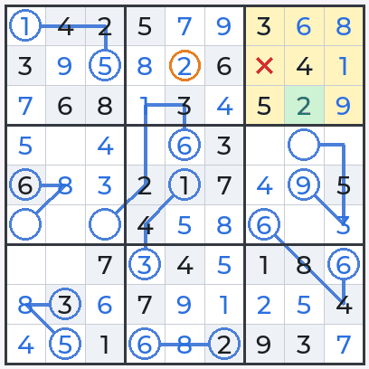

#### Step 41: the 7 in box 3

Box 3 needs a 7, and r2c7 is its last empty cell: **r2c7 = 7**.

#### Step 42: the 9 in box 4

Box 4 needs a 9. r4c2 and r6c2: column 2 has one (r2c2). r6c1: it's a circle: the cells between add up to 8 and the other circle is 6, so it's 2. Only **r6c3** is left: **r6c3 = 9**.

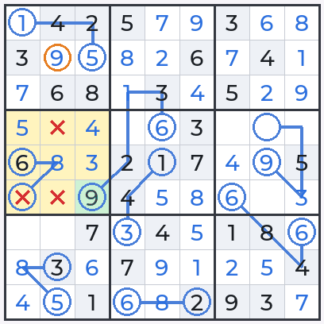

#### Step 43: the 9 in box 5

Box 5 needs a 9, and r4c4 is its last empty cell: **r4c4 = 9**.

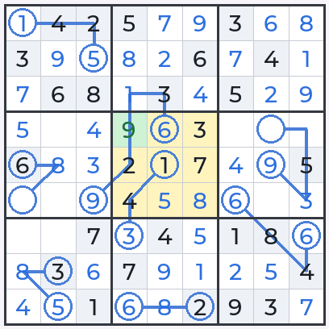

#### Step 44: the 2 in box 6

Box 6 needs a 2. r4c7: column 7 has one (r8c7). r4c8 and r6c8: column 8 has one (r3c8). Only **r4c9** is left: **r4c9 = 2**.

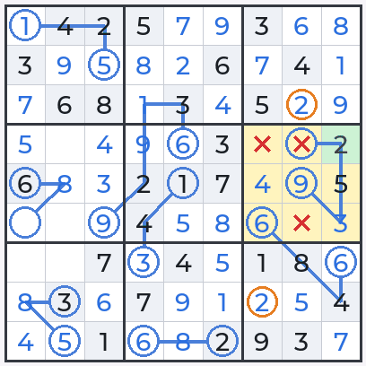

#### Step 45: the 7 in box 6

Box 6 needs a 7. r4c7: column 7 has one (r2c7). r4c8: it's a circle: the cells between add up to 10 and the other circle is 9, so it's 1. Only **r6c8** is left: **r6c8 = 7**.

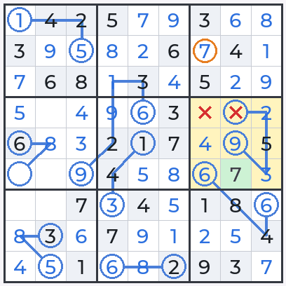

#### Step 46: the 7 in box 4

Box 4 needs a 7. r6c1 and r6c2: row 6 has one (r6c8). Only **r4c2** is left: **r4c2 = 7**.

#### Step 47: the 1 in box 4

Box 4 needs a 1. r6c1: column 1 has one (r1c1). Only **r6c2** is left: **r6c2 = 1**.

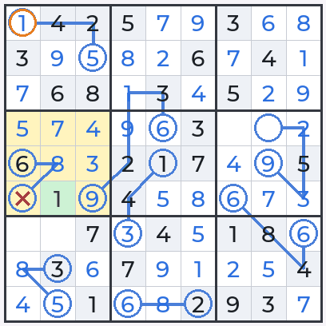

#### Step 48: the 2 in box 4

Box 4 needs a 2, and r6c1 is its last empty cell: **r6c1 = 2**.

#### Step 49: the 1 in box 6

Box 6 needs a 1. r4c7: column 7 has one (r7c7). Only **r4c8** is left: **r4c8 = 1**.

#### Step 50: the 8 in box 6

Box 6 needs an 8, and r4c7 is its last empty cell: **r4c7 = 8**.

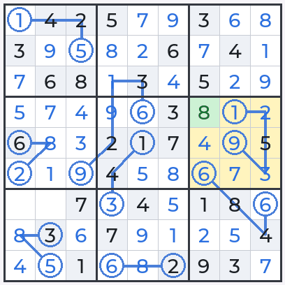

#### Step 51: the 2 in box 7

Box 7 needs a 2. r7c1: column 1 has one (r6c1). Only **r7c2** is left: **r7c2 = 2**.

#### Step 52: the 9 in box 7

Box 7 needs a 9, and r7c1 is its last empty cell: **r7c1 = 9**.

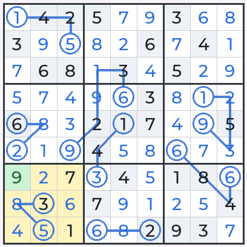

Solved.

<!-- /walkthrough -->
