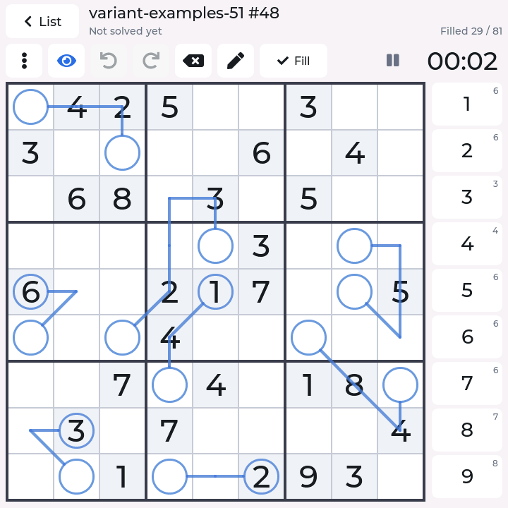
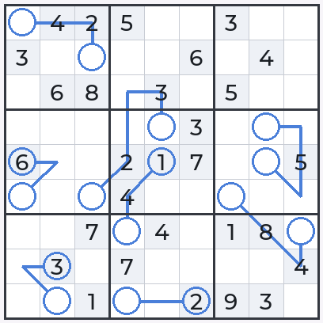

# Double Arrow

[← All variants](README.md) · [Puzzles](../features-puzzles.md) · [How to play](../how-to-play.md)

## The rules

[Classic](classic.md) rules, and **blue lines with a circle at each end**: the two circles' digits **add up to the digits between them**. In 3, 5, 4, 6 the circles 3 and 6 make 9, and so do 5 and 4. The circles can hold the same digit where they don't see each other. A line has 3 to 6 cells.

## On the board

- The lines are thin and blue, from circle to circle, through the cell centres; lines don't cross each other.
- Once both circles are filled, the line's digits turn red when the cells between add up to more than the circles (counting 1 for each empty one), or, all filled, to something else.
- The grader and hints bound each cell by the sums the others still allow: "The two circles at this line's ends add up to the digits between them, so row 2, column 3 can only be 5."
- **Puzzles → ⋮ → New puzzle → Lines → Double Arrow**: 8 lines (Hard and Expert: 10).

## How to solve it

- **The circles make 18 at most** (17 when they see each other), so the cells between can't add up to more.
- **Two cells between: small circles mean small digits.** A line of 4 cells whose middle holds a 7 and an 8 needs circles adding up to 15.
- **One circle known:** the other is the sum between, less it. With the cells between full, the last circle is a subtraction.

## Worked example

**variant-examples #48**, Double Arrow Easy (see [Classic](classic.md#worked-example-the-whole-puzzle) for how to import the examples; cells are written r*row*c*column*).

**Step 1: r2c3.** Column 3 has 1, 2, 7 and 8; row 2 has 3, 4 and 6: that leaves 5 and 9. r2c3 is a circle of the line r1c1, r1c2, r1c3, r2c3, and the 4 and the 2 between add up to 6: a 9 is already too much. **r2c3 = 5** (and the other circle, r1c1, will be 1).

**Step 2: r7c9.** Row 7 has 1, 4, 7 and 8; box 9 has 3 and 9; column 9 has 5: that leaves 2 and 6. r7c9 is a circle of the line r6c7, r7c8, r8c9, r7c9, and the 8 and the 4 between make 12: with a 2, the other circle would need 10. **r7c9 = 6** (and r6c7, the other circle, 6 too: they don't see each other).

**Step 3: r9c2.** Row 9 has 1, 2, 3 and 9; column 2 has 4 and 6; box 7 has 7: that leaves 5 and 8. r9c2 and the 3 in r8c2 are the circles of a short line, the one cell between being r8c1: 8 + 3 = 11, too much for one digit. **r9c2 = 5** (and r8c1 = 8).

## The whole puzzle, step by step

<!-- walkthrough -->
<!-- Written by tools/walkthrough.py double-arrow: edit the script, not this part. -->

The whole puzzle, from the start to the last cell: 52 steps, each one a single (one place left for a digit, or one digit left for a cell), taken in the order a box's single comes first, so not quite the order of the worked example above. Each step has a page of its own, with **Previous** and **Next**: pick its number below. In each picture, the unit the step looks at is tinted yellow (for a cell with one digit left: its row, column and box), the new digit is on green, the digits that rule cells out have an **orange ring**, and the empty cells they rule out a **red cross**. Givens are on grey, digits from earlier steps in blue.

| [1](double-arrow/step-01.md) | [2](double-arrow/step-02.md) | [3](double-arrow/step-03.md) | [4](double-arrow/step-04.md) | [5](double-arrow/step-05.md) | [6](double-arrow/step-06.md) | [7](double-arrow/step-07.md) | [8](double-arrow/step-08.md) | [9](double-arrow/step-09.md) | [10](double-arrow/step-10.md) |
|:-:|:-:|:-:|:-:|:-:|:-:|:-:|:-:|:-:|:-:|
| [11](double-arrow/step-11.md) | [12](double-arrow/step-12.md) | [13](double-arrow/step-13.md) | [14](double-arrow/step-14.md) | [15](double-arrow/step-15.md) | [16](double-arrow/step-16.md) | [17](double-arrow/step-17.md) | [18](double-arrow/step-18.md) | [19](double-arrow/step-19.md) | [20](double-arrow/step-20.md) |
| [21](double-arrow/step-21.md) | [22](double-arrow/step-22.md) | [23](double-arrow/step-23.md) | [24](double-arrow/step-24.md) | [25](double-arrow/step-25.md) | [26](double-arrow/step-26.md) | [27](double-arrow/step-27.md) | [28](double-arrow/step-28.md) | [29](double-arrow/step-29.md) | [30](double-arrow/step-30.md) |
| [31](double-arrow/step-31.md) | [32](double-arrow/step-32.md) | [33](double-arrow/step-33.md) | [34](double-arrow/step-34.md) | [35](double-arrow/step-35.md) | [36](double-arrow/step-36.md) | [37](double-arrow/step-37.md) | [38](double-arrow/step-38.md) | [39](double-arrow/step-39.md) | [40](double-arrow/step-40.md) |
| [41](double-arrow/step-41.md) | [42](double-arrow/step-42.md) | [43](double-arrow/step-43.md) | [44](double-arrow/step-44.md) | [45](double-arrow/step-45.md) | [46](double-arrow/step-46.md) | [47](double-arrow/step-47.md) | [48](double-arrow/step-48.md) | [49](double-arrow/step-49.md) | [50](double-arrow/step-50.md) |
| [51](double-arrow/step-51.md) | [52](double-arrow/step-52.md) |  |  |  |  |  |  |  |  |

Solved.

<!-- /walkthrough -->
