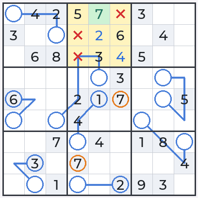

<!-- Written by tools/walkthrough.py double-arrow: edit the script, not this page. -->
# Double Arrow, step 3: the 7 in box 2

**Step 3 of 52** · [← Step 2](step-02.md) · [All steps](../double-arrow.md#the-whole-puzzle-step-by-step) · [Step 4 →](step-04.md)

Box 2 needs a 7. r1c6: column 6 has one (r5c6). r2c4 and r3c4: column 4 has one (r8c4). Only **r1c5** is left: **r1c5 = 7**.

**Step 3 of 52** · [← Step 2](step-02.md) · [All steps](../double-arrow.md#the-whole-puzzle-step-by-step) · [Step 4 →](step-04.md)
