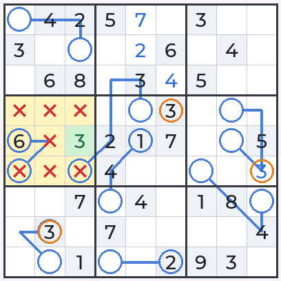

<!-- Written by tools/walkthrough.py double-arrow: edit the script, not this page. -->
# Double Arrow, step 5: the 3 in box 4

**Step 5 of 52** · [← Step 4](step-04.md) · [All steps](../double-arrow.md#the-whole-puzzle-step-by-step) · [Step 6 →](step-06.md)

Box 4 needs a 3. r4c1, r4c2 and r4c3: row 4 has one (r4c6). r5c2: column 2 has one (r8c2). r6c1, r6c2 and r6c3: row 6 has one (r6c9). Only **r5c3** is left: **r5c3 = 3**.

**Step 5 of 52** · [← Step 4](step-04.md) · [All steps](../double-arrow.md#the-whole-puzzle-step-by-step) · [Step 6 →](step-06.md)
