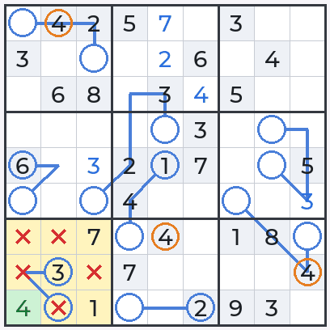

<!-- Written by tools/walkthrough.py double-arrow: edit the script, not this page. -->
# Double Arrow, step 6: the 4 in box 7

**Step 6 of 52** · [← Step 5](step-05.md) · [All steps](../double-arrow.md#the-whole-puzzle-step-by-step) · [Step 7 →](step-07.md)

Box 7 needs a 4. r7c1 and r7c2: row 7 has one (r7c5). r8c1 and r8c3: row 8 has one (r8c9). r9c2: column 2 has one (r1c2). Only **r9c1** is left: **r9c1 = 4**.

**Step 6 of 52** · [← Step 5](step-05.md) · [All steps](../double-arrow.md#the-whole-puzzle-step-by-step) · [Step 7 →](step-07.md)
