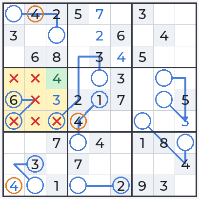

<!-- Written by tools/walkthrough.py double-arrow: edit the script, not this page. -->
# Double Arrow, step 7: the 4 in box 4

**Step 7 of 52** · [← Step 6](step-06.md) · [All steps](../double-arrow.md#the-whole-puzzle-step-by-step) · [Step 8 →](step-08.md)

Box 4 needs a 4. r4c1: column 1 has one (r9c1). r4c2 and r5c2: column 2 has one (r1c2). r6c1, r6c2 and r6c3: row 6 has one (r6c4). Only **r4c3** is left: **r4c3 = 4**.

**Step 7 of 52** · [← Step 6](step-06.md) · [All steps](../double-arrow.md#the-whole-puzzle-step-by-step) · [Step 8 →](step-08.md)
