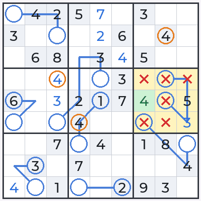

<!-- Written by tools/walkthrough.py double-arrow: edit the script, not this page. -->
# Double Arrow, step 8: the 4 in box 6

**Step 8 of 52** · [← Step 7](step-07.md) · [All steps](../double-arrow.md#the-whole-puzzle-step-by-step) · [Step 9 →](step-09.md)

Box 6 needs a 4. r4c7, r4c8 and r4c9: row 4 has one (r4c3). r5c8: column 8 has one (r2c8). r6c7 and r6c8: row 6 has one (r6c4). Only **r5c7** is left: **r5c7 = 4**.

**Step 8 of 52** · [← Step 7](step-07.md) · [All steps](../double-arrow.md#the-whole-puzzle-step-by-step) · [Step 9 →](step-09.md)
