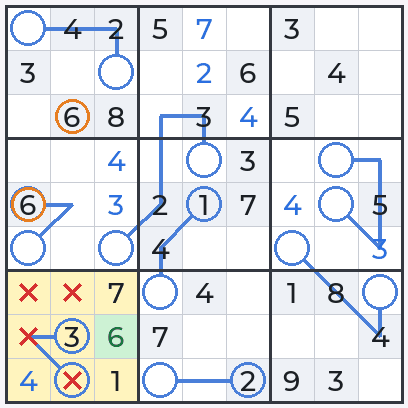

<!-- Written by tools/walkthrough.py double-arrow: edit the script, not this page. -->
# Double Arrow, step 9: the 6 in box 7

**Step 9 of 52** · [← Step 8](step-08.md) · [All steps](../double-arrow.md#the-whole-puzzle-step-by-step) · [Step 10 →](step-10.md)

Box 7 needs a 6. r7c1 and r8c1: column 1 has one (r5c1). r7c2 and r9c2: column 2 has one (r3c2). Only **r8c3** is left: **r8c3 = 6**.

**Step 9 of 52** · [← Step 8](step-08.md) · [All steps](../double-arrow.md#the-whole-puzzle-step-by-step) · [Step 10 →](step-10.md)
