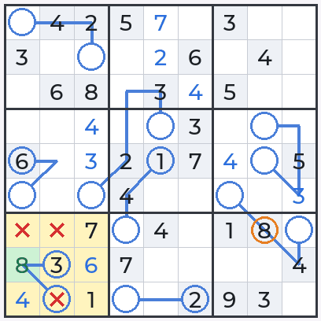

<!-- Written by tools/walkthrough.py double-arrow: edit the script, not this page. -->
# Double Arrow, step 10: the 8 in box 7

**Step 10 of 52** · [← Step 9](step-09.md) · [All steps](../double-arrow.md#the-whole-puzzle-step-by-step) · [Step 11 →](step-11.md)

Box 7 needs an 8. r7c1 and r7c2: row 7 has one (r7c8). r9c2: it's a circle, and with an 8 there the two circles couldn't add up to the cells between them. Only **r8c1** is left: **r8c1 = 8**.

**Step 10 of 52** · [← Step 9](step-09.md) · [All steps](../double-arrow.md#the-whole-puzzle-step-by-step) · [Step 11 →](step-11.md)
