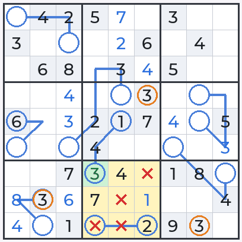

<!-- Written by tools/walkthrough.py double-arrow: edit the script, not this page. -->
# Double Arrow, step 12: the 3 in box 8

**Step 12 of 52** · [← Step 11](step-11.md) · [All steps](../double-arrow.md#the-whole-puzzle-step-by-step) · [Step 13 →](step-13.md)

Box 8 needs a 3. r7c6: column 6 has one (r4c6). r8c5: row 8 has one (r8c2). r9c4 and r9c5: row 9 has one (r9c8). Only **r7c4** is left: **r7c4 = 3**.

**Step 12 of 52** · [← Step 11](step-11.md) · [All steps](../double-arrow.md#the-whole-puzzle-step-by-step) · [Step 13 →](step-13.md)
