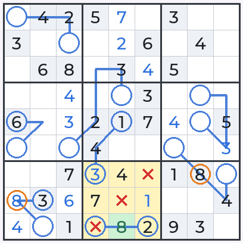

<!-- Written by tools/walkthrough.py double-arrow: edit the script, not this page. -->
# Double Arrow, step 13: the 8 in box 8

**Step 13 of 52** · [← Step 12](step-12.md) · [All steps](../double-arrow.md#the-whole-puzzle-step-by-step) · [Step 14 →](step-14.md)

Box 8 needs an 8. r7c6: row 7 has one (r7c8). r8c5: row 8 has one (r8c1). r9c4: it's a circle, and with an 8 there the two circles couldn't add up to the cells between them. Only **r9c5** is left: **r9c5 = 8**.

**Step 13 of 52** · [← Step 12](step-12.md) · [All steps](../double-arrow.md#the-whole-puzzle-step-by-step) · [Step 14 →](step-14.md)
