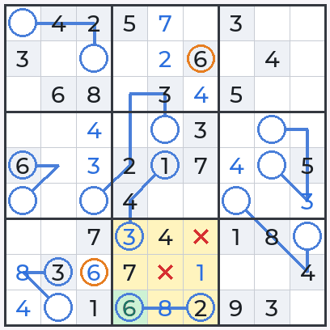

<!-- Written by tools/walkthrough.py double-arrow: edit the script, not this page. -->
# Double Arrow, step 14: the 6 in box 8

**Step 14 of 52** · [← Step 13](step-13.md) · [All steps](../double-arrow.md#the-whole-puzzle-step-by-step) · [Step 15 →](step-15.md)

Box 8 needs a 6. r7c6: column 6 has one (r2c6). r8c5: row 8 has one (r8c3). Only **r9c4** is left: **r9c4 = 6**.

**Step 14 of 52** · [← Step 13](step-13.md) · [All steps](../double-arrow.md#the-whole-puzzle-step-by-step) · [Step 15 →](step-15.md)
