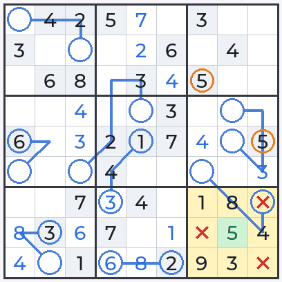

<!-- Written by tools/walkthrough.py double-arrow: edit the script, not this page. -->
# Double Arrow, step 15: the 5 in box 9

**Step 15 of 52** · [← Step 14](step-14.md) · [All steps](../double-arrow.md#the-whole-puzzle-step-by-step) · [Step 16 →](step-16.md)

Box 9 needs a 5. r7c9 and r9c9: column 9 has one (r5c9). r8c7: column 7 has one (r3c7). Only **r8c8** is left: **r8c8 = 5**.

**Step 15 of 52** · [← Step 14](step-14.md) · [All steps](../double-arrow.md#the-whole-puzzle-step-by-step) · [Step 16 →](step-16.md)
