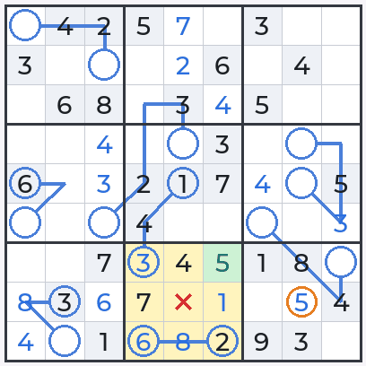

<!-- Written by tools/walkthrough.py double-arrow: edit the script, not this page. -->
# Double Arrow, step 16: the 5 in box 8

**Step 16 of 52** · [← Step 15](step-15.md) · [All steps](../double-arrow.md#the-whole-puzzle-step-by-step) · [Step 17 →](step-17.md)

Box 8 needs a 5. r8c5: row 8 has one (r8c8). Only **r7c6** is left: **r7c6 = 5**.

**Step 16 of 52** · [← Step 15](step-15.md) · [All steps](../double-arrow.md#the-whole-puzzle-step-by-step) · [Step 17 →](step-17.md)
