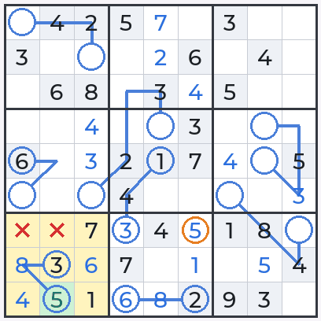

<!-- Written by tools/walkthrough.py double-arrow: edit the script, not this page. -->
# Double Arrow, step 17: the 5 in box 7

**Step 17 of 52** · [← Step 16](step-16.md) · [All steps](../double-arrow.md#the-whole-puzzle-step-by-step) · [Step 18 →](step-18.md)

Box 7 needs a 5. r7c1 and r7c2: row 7 has one (r7c6). Only **r9c2** is left: **r9c2 = 5**.

**Step 17 of 52** · [← Step 16](step-16.md) · [All steps](../double-arrow.md#the-whole-puzzle-step-by-step) · [Step 18 →](step-18.md)
