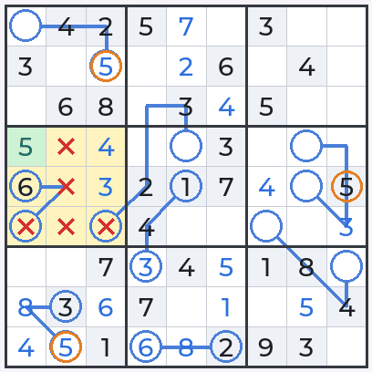

<!-- Written by tools/walkthrough.py double-arrow: edit the script, not this page. -->
# Double Arrow, step 19: the 5 in box 4

**Step 19 of 52** · [← Step 18](step-18.md) · [All steps](../double-arrow.md#the-whole-puzzle-step-by-step) · [Step 20 →](step-20.md)

Box 4 needs a 5. r4c2 and r6c2: column 2 has one (r9c2). r5c2: row 5 has one (r5c9). r6c3: column 3 has one (r2c3). r6c1: it's a circle, and with a 5 there the two circles couldn't add up to the cells between them. Only **r4c1** is left: **r4c1 = 5**.

**Step 19 of 52** · [← Step 18](step-18.md) · [All steps](../double-arrow.md#the-whole-puzzle-step-by-step) · [Step 20 →](step-20.md)
