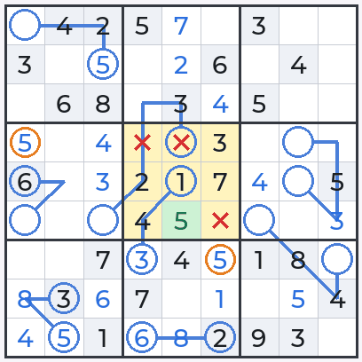

<!-- Written by tools/walkthrough.py double-arrow: edit the script, not this page. -->
# Double Arrow, step 20: the 5 in box 5

**Step 20 of 52** · [← Step 19](step-19.md) · [All steps](../double-arrow.md#the-whole-puzzle-step-by-step) · [Step 21 →](step-21.md)

Box 5 needs a 5. r4c4 and r4c5: row 4 has one (r4c1). r6c6: column 6 has one (r7c6). Only **r6c5** is left: **r6c5 = 5**.

**Step 20 of 52** · [← Step 19](step-19.md) · [All steps](../double-arrow.md#the-whole-puzzle-step-by-step) · [Step 21 →](step-21.md)
