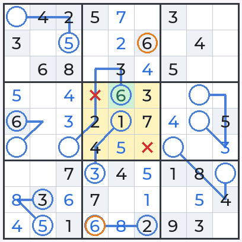

<!-- Written by tools/walkthrough.py double-arrow: edit the script, not this page. -->
# Double Arrow, step 21: the 6 in box 5

**Step 21 of 52** · [← Step 20](step-20.md) · [All steps](../double-arrow.md#the-whole-puzzle-step-by-step) · [Step 22 →](step-22.md)

Box 5 needs a 6. r4c4: column 4 has one (r9c4). r6c6: column 6 has one (r2c6). Only **r4c5** is left: **r4c5 = 6**.

**Step 21 of 52** · [← Step 20](step-20.md) · [All steps](../double-arrow.md#the-whole-puzzle-step-by-step) · [Step 22 →](step-22.md)
