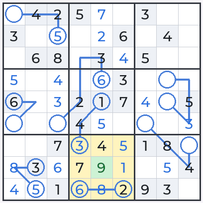

<!-- Written by tools/walkthrough.py double-arrow: edit the script, not this page. -->
# Double Arrow, step 22: the 9 in box 8

**Step 22 of 52** · [← Step 21](step-21.md) · [All steps](../double-arrow.md#the-whole-puzzle-step-by-step) · [Step 23 →](step-23.md)

Box 8 needs a 9, and r8c5 is its last empty cell: **r8c5 = 9**.

**Step 22 of 52** · [← Step 21](step-21.md) · [All steps](../double-arrow.md#the-whole-puzzle-step-by-step) · [Step 23 →](step-23.md)
