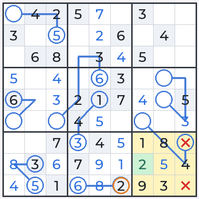

<!-- Written by tools/walkthrough.py double-arrow: edit the script, not this page. -->
# Double Arrow, step 23: the 2 in box 9

**Step 23 of 52** · [← Step 22](step-22.md) · [All steps](../double-arrow.md#the-whole-puzzle-step-by-step) · [Step 24 →](step-24.md)

Box 9 needs a 2. r9c9: row 9 has one (r9c6). r7c9: it's a circle, and with a 2 there the two circles couldn't add up to the cells between them. Only **r8c7** is left: **r8c7 = 2**.

**Step 23 of 52** · [← Step 22](step-22.md) · [All steps](../double-arrow.md#the-whole-puzzle-step-by-step) · [Step 24 →](step-24.md)
