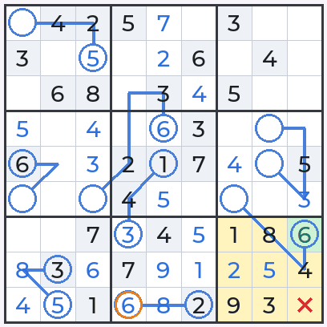

<!-- Written by tools/walkthrough.py double-arrow: edit the script, not this page. -->
# Double Arrow, step 24: the 6 in box 9

**Step 24 of 52** · [← Step 23](step-23.md) · [All steps](../double-arrow.md#the-whole-puzzle-step-by-step) · [Step 25 →](step-25.md)

Box 9 needs a 6. r9c9: row 9 has one (r9c4). Only **r7c9** is left: **r7c9 = 6**.

**Step 24 of 52** · [← Step 23](step-23.md) · [All steps](../double-arrow.md#the-whole-puzzle-step-by-step) · [Step 25 →](step-25.md)
