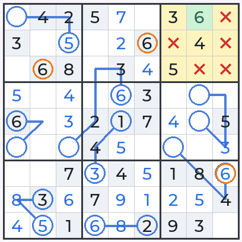

<!-- Written by tools/walkthrough.py double-arrow: edit the script, not this page. -->
# Double Arrow, step 25: the 6 in box 3

**Step 25 of 52** · [← Step 24](step-24.md) · [All steps](../double-arrow.md#the-whole-puzzle-step-by-step) · [Step 26 →](step-26.md)

Box 3 needs a 6. r1c9: column 9 has one (r7c9). r2c7 and r2c9: row 2 has one (r2c6). r3c8 and r3c9: row 3 has one (r3c2). Only **r1c8** is left: **r1c8 = 6**.

**Step 25 of 52** · [← Step 24](step-24.md) · [All steps](../double-arrow.md#the-whole-puzzle-step-by-step) · [Step 26 →](step-26.md)
