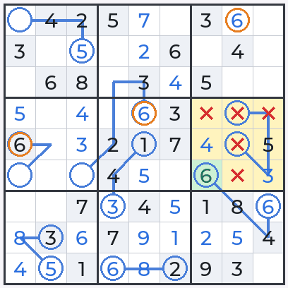

<!-- Written by tools/walkthrough.py double-arrow: edit the script, not this page. -->
# Double Arrow, step 26: the 6 in box 6

**Step 26 of 52** · [← Step 25](step-25.md) · [All steps](../double-arrow.md#the-whole-puzzle-step-by-step) · [Step 27 →](step-27.md)

Box 6 needs a 6. r4c7, r4c8 and r4c9: row 4 has one (r4c5). r5c8: row 5 has one (r5c1). r6c8: column 8 has one (r1c8). Only **r6c7** is left: **r6c7 = 6**.

**Step 26 of 52** · [← Step 25](step-25.md) · [All steps](../double-arrow.md#the-whole-puzzle-step-by-step) · [Step 27 →](step-27.md)
