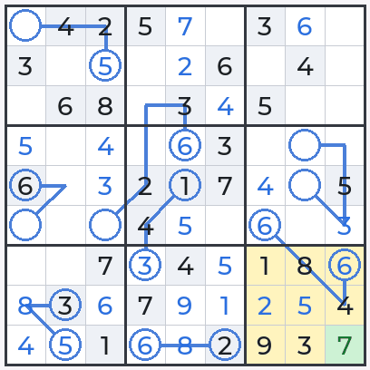

<!-- Written by tools/walkthrough.py double-arrow: edit the script, not this page. -->
# Double Arrow, step 27: the 7 in box 9

**Step 27 of 52** · [← Step 26](step-26.md) · [All steps](../double-arrow.md#the-whole-puzzle-step-by-step) · [Step 28 →](step-28.md)

Box 9 needs a 7, and r9c9 is its last empty cell: **r9c9 = 7**.

**Step 27 of 52** · [← Step 26](step-26.md) · [All steps](../double-arrow.md#the-whole-puzzle-step-by-step) · [Step 28 →](step-28.md)
