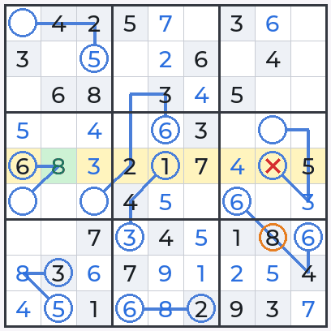

<!-- Written by tools/walkthrough.py double-arrow: edit the script, not this page. -->
# Double Arrow, step 28: the 8 in row 5

**Step 28 of 52** · [← Step 27](step-27.md) · [All steps](../double-arrow.md#the-whole-puzzle-step-by-step) · [Step 29 →](step-29.md)

Row 5 needs an 8. r5c8: column 8 has one (r7c8). Only **r5c2** is left: **r5c2 = 8**.

**Step 28 of 52** · [← Step 27](step-27.md) · [All steps](../double-arrow.md#the-whole-puzzle-step-by-step) · [Step 29 →](step-29.md)
