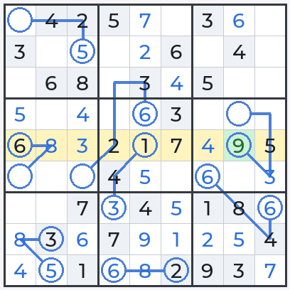

<!-- Written by tools/walkthrough.py double-arrow: edit the script, not this page. -->
# Double Arrow, step 29: the 9 in row 5

**Step 29 of 52** · [← Step 28](step-28.md) · [All steps](../double-arrow.md#the-whole-puzzle-step-by-step) · [Step 30 →](step-30.md)

Row 5 needs a 9, and r5c8 is its last empty cell: **r5c8 = 9**.

**Step 29 of 52** · [← Step 28](step-28.md) · [All steps](../double-arrow.md#the-whole-puzzle-step-by-step) · [Step 30 →](step-30.md)
