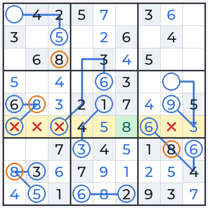

<!-- Written by tools/walkthrough.py double-arrow: edit the script, not this page. -->
# Double Arrow, step 30: the 8 in row 6

**Step 30 of 52** · [← Step 29](step-29.md) · [All steps](../double-arrow.md#the-whole-puzzle-step-by-step) · [Step 31 →](step-31.md)

Row 6 needs an 8. r6c1: column 1 has one (r8c1). r6c2: column 2 has one (r5c2). r6c3: column 3 has one (r3c3). r6c8: column 8 has one (r7c8). Only **r6c6** is left: **r6c6 = 8**.

**Step 30 of 52** · [← Step 29](step-29.md) · [All steps](../double-arrow.md#the-whole-puzzle-step-by-step) · [Step 31 →](step-31.md)
