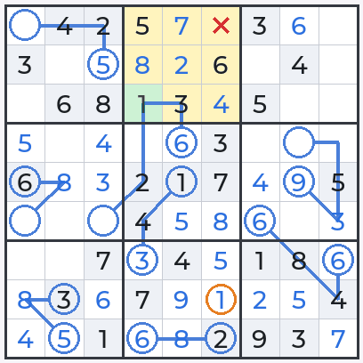

<!-- Written by tools/walkthrough.py double-arrow: edit the script, not this page. -->
# Double Arrow, step 32: the 1 in box 2

**Step 32 of 52** · [← Step 31](step-31.md) · [All steps](../double-arrow.md#the-whole-puzzle-step-by-step) · [Step 33 →](step-33.md)

Box 2 needs a 1. r1c6: column 6 has one (r8c6). Only **r3c4** is left: **r3c4 = 1**.

**Step 32 of 52** · [← Step 31](step-31.md) · [All steps](../double-arrow.md#the-whole-puzzle-step-by-step) · [Step 33 →](step-33.md)
