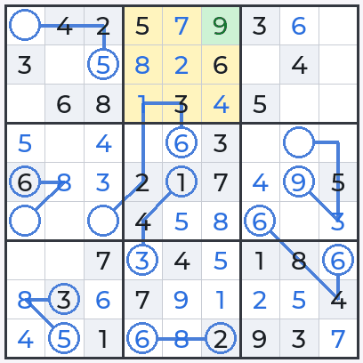

<!-- Written by tools/walkthrough.py double-arrow: edit the script, not this page. -->
# Double Arrow, step 33: the 9 in box 2

**Step 33 of 52** · [← Step 32](step-32.md) · [All steps](../double-arrow.md#the-whole-puzzle-step-by-step) · [Step 34 →](step-34.md)

Box 2 needs a 9, and r1c6 is its last empty cell: **r1c6 = 9**.

**Step 33 of 52** · [← Step 32](step-32.md) · [All steps](../double-arrow.md#the-whole-puzzle-step-by-step) · [Step 34 →](step-34.md)
