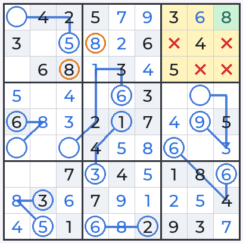

<!-- Written by tools/walkthrough.py double-arrow: edit the script, not this page. -->
# Double Arrow, step 34: the 8 in box 3

**Step 34 of 52** · [← Step 33](step-33.md) · [All steps](../double-arrow.md#the-whole-puzzle-step-by-step) · [Step 35 →](step-35.md)

Box 3 needs an 8. r2c7 and r2c9: row 2 has one (r2c4). r3c8 and r3c9: row 3 has one (r3c3). Only **r1c9** is left: **r1c9 = 8**.

**Step 34 of 52** · [← Step 33](step-33.md) · [All steps](../double-arrow.md#the-whole-puzzle-step-by-step) · [Step 35 →](step-35.md)
