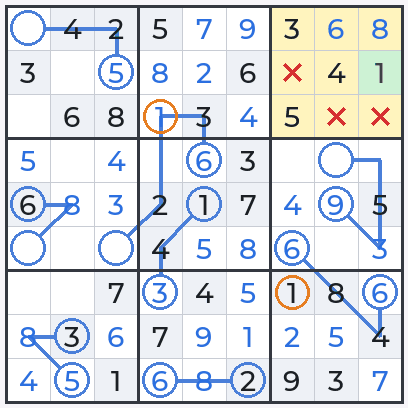

<!-- Written by tools/walkthrough.py double-arrow: edit the script, not this page. -->
# Double Arrow, step 35: the 1 in box 3

**Step 35 of 52** · [← Step 34](step-34.md) · [All steps](../double-arrow.md#the-whole-puzzle-step-by-step) · [Step 36 →](step-36.md)

Box 3 needs a 1. r2c7: column 7 has one (r7c7). r3c8 and r3c9: row 3 has one (r3c4). Only **r2c9** is left: **r2c9 = 1**.

**Step 35 of 52** · [← Step 34](step-34.md) · [All steps](../double-arrow.md#the-whole-puzzle-step-by-step) · [Step 36 →](step-36.md)
