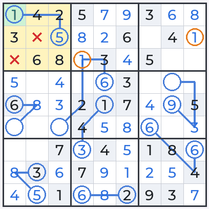

<!-- Written by tools/walkthrough.py double-arrow: edit the script, not this page. -->
# Double Arrow, step 36: the 1 in box 1

**Step 36 of 52** · [← Step 35](step-35.md) · [All steps](../double-arrow.md#the-whole-puzzle-step-by-step) · [Step 37 →](step-37.md)

Box 1 needs a 1. r2c2: row 2 has one (r2c9). r3c1: row 3 has one (r3c4). Only **r1c1** is left: **r1c1 = 1**.

**Step 36 of 52** · [← Step 35](step-35.md) · [All steps](../double-arrow.md#the-whole-puzzle-step-by-step) · [Step 37 →](step-37.md)
