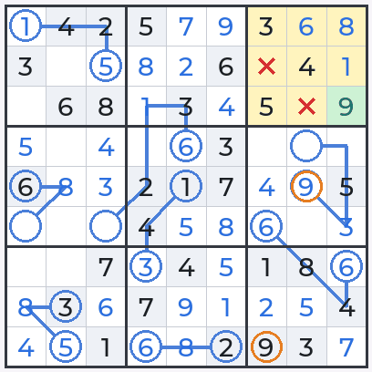

<!-- Written by tools/walkthrough.py double-arrow: edit the script, not this page. -->
# Double Arrow, step 37: the 9 in box 3

**Step 37 of 52** · [← Step 36](step-36.md) · [All steps](../double-arrow.md#the-whole-puzzle-step-by-step) · [Step 38 →](step-38.md)

Box 3 needs a 9. r2c7: column 7 has one (r9c7). r3c8: column 8 has one (r5c8). Only **r3c9** is left: **r3c9 = 9**.

**Step 37 of 52** · [← Step 36](step-36.md) · [All steps](../double-arrow.md#the-whole-puzzle-step-by-step) · [Step 38 →](step-38.md)
