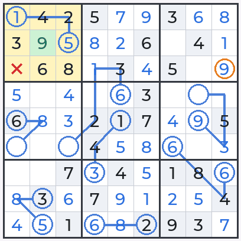

<!-- Written by tools/walkthrough.py double-arrow: edit the script, not this page. -->
# Double Arrow, step 38: the 9 in box 1

**Step 38 of 52** · [← Step 37](step-37.md) · [All steps](../double-arrow.md#the-whole-puzzle-step-by-step) · [Step 39 →](step-39.md)

Box 1 needs a 9. r3c1: row 3 has one (r3c9). Only **r2c2** is left: **r2c2 = 9**.

**Step 38 of 52** · [← Step 37](step-37.md) · [All steps](../double-arrow.md#the-whole-puzzle-step-by-step) · [Step 39 →](step-39.md)
