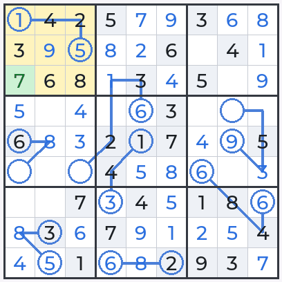

<!-- Written by tools/walkthrough.py double-arrow: edit the script, not this page. -->
# Double Arrow, step 39: the 7 in box 1

**Step 39 of 52** · [← Step 38](step-38.md) · [All steps](../double-arrow.md#the-whole-puzzle-step-by-step) · [Step 40 →](step-40.md)

Box 1 needs a 7, and r3c1 is its last empty cell: **r3c1 = 7**.

**Step 39 of 52** · [← Step 38](step-38.md) · [All steps](../double-arrow.md#the-whole-puzzle-step-by-step) · [Step 40 →](step-40.md)
