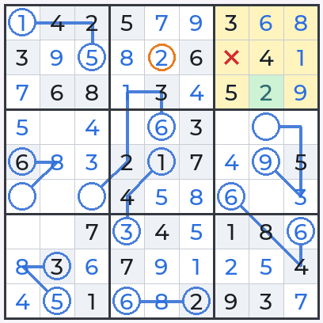

<!-- Written by tools/walkthrough.py double-arrow: edit the script, not this page. -->
# Double Arrow, step 40: the 2 in box 3

**Step 40 of 52** · [← Step 39](step-39.md) · [All steps](../double-arrow.md#the-whole-puzzle-step-by-step) · [Step 41 →](step-41.md)

Box 3 needs a 2. r2c7: row 2 has one (r2c5). Only **r3c8** is left: **r3c8 = 2**.

**Step 40 of 52** · [← Step 39](step-39.md) · [All steps](../double-arrow.md#the-whole-puzzle-step-by-step) · [Step 41 →](step-41.md)
