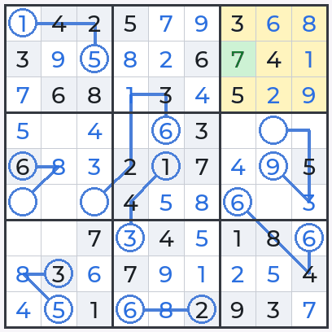

<!-- Written by tools/walkthrough.py double-arrow: edit the script, not this page. -->
# Double Arrow, step 41: the 7 in box 3

**Step 41 of 52** · [← Step 40](step-40.md) · [All steps](../double-arrow.md#the-whole-puzzle-step-by-step) · [Step 42 →](step-42.md)

Box 3 needs a 7, and r2c7 is its last empty cell: **r2c7 = 7**.

**Step 41 of 52** · [← Step 40](step-40.md) · [All steps](../double-arrow.md#the-whole-puzzle-step-by-step) · [Step 42 →](step-42.md)
